# SL MULTISHOP – MASTER ENTITY-RELATIONSHIP (ER) DOCUMENTATION
**Product:** SL MultiShop  
**Company:** SL IT SOLUTIONS  

---

## 1. Relational Architecture & Multi-Tenant Model

SL MultiShop operates on a shared-database, shared-schema multi-tenant architecture with PostgreSQL Row-Level Security (RLS) enforcement and tenant-scoped database sessions.

```mermaid
erDiagram
    %% Core Tenant & Users
    SHOPS ||--o{ BRANCHES : "contains"
    BRANCHES ||--o{ COUNTERS : "operates"
    SHOPS ||--o{ USER_ROLES : "employs"
    USERS ||--o{ USER_ROLES : "assigned_to"
    ROLES ||--o{ USER_ROLES : "categorizes"
    ROLES ||--o{ ROLE_PERMISSIONS : "grants"
    PERMISSIONS ||--o{ ROLE_PERMISSIONS : "defines"
    USERS ||--o{ REFRESH_TOKENS : "holds"

    %% Subscriptions & Billing
    PLANS ||--o{ SUBSCRIPTIONS : "plans"
    SHOPS ||--o{ SUBSCRIPTIONS : "subscribes"
    SUBSCRIPTIONS ||--o{ SUBSCRIPTION_PAYMENTS : "settles"

    %% Catalog & Inventory
    SHOPS ||--o{ CATEGORIES : "organizes"
    SHOPS ||--o{ BRANDS : "brands"
    SHOPS ||--o{ UNITS : "measures"
    SHOPS ||--o{ PRODUCTS : "stocks"
    CATEGORIES ||--o{ PRODUCTS : "classifies"
    BRANDS ||--o{ PRODUCTS : "labels"
    UNITS ||--o{ PRODUCTS : "quantifies"
    PRODUCTS ||--o{ PRODUCT_VARIANTS : "variants"
    PRODUCTS ||--o{ PRODUCT_BARCODES : "scannable_by"
    PRODUCT_VARIANTS ||--o{ PRODUCT_BARCODES : "barcoded"

    %% Stock Management
    BRANCHES ||--o{ STOCK_BALANCES : "maintains"
    PRODUCTS ||--o{ STOCK_BALANCES : "balanced_for"
    BRANCHES ||--o{ STOCK_MOVEMENTS : "logs_in"
    PRODUCTS ||--o{ STOCK_MOVEMENTS : "movement_of"
    BRANCHES ||--o{ STOCK_TRANSFERS : "transfers_from"
    BRANCHES ||--o{ STOCK_TRANSFERS : "transfers_to"

    %% Sales & Point of Sale
    SHOPS ||--o{ INVOICES : "issues"
    BRANCHES ||--o{ INVOICES : "billed_at"
    COUNTERS ||--o{ INVOICES : "processed_at"
    CUSTOMERS ||--o{ INVOICES : "billed_to"
    INVOICES ||--o{ INVOICE_ITEMS : "contains"
    INVOICES ||--o{ INVOICE_TAXES : "calculates"
    INVOICES ||--o{ PAYMENTS : "paid_by"
    PAYMENTS ||--o{ PAYMENT_ALLOCATIONS : "allocates"
    INVOICES ||--o{ SALES_RETURNS : "refunded_by"
    SALES_RETURNS ||--o{ SALES_RETURN_ITEMS : "refund_items"
    CUSTOMERS ||--o{ CREDIT_NOTES : "credits"

    %% Customers & Procurement
    SHOPS ||--o{ CUSTOMERS : "serves"
    CUSTOMERS ||--o{ CUSTOMER_ADDRESSES : "lives_at"
    CUSTOMERS ||--o{ CUSTOMER_LEDGER : "transacts"
    SHOPS ||--o{ SUPPLIERS : "procures_from"
    SUPPLIERS ||--o{ PURCHASE_ORDERS : "supplies"
    PURCHASE_ORDERS ||--o{ PURCHASE_ITEMS : "lines"
    PURCHASE_ORDERS ||--o{ GOODS_RECEIPTS : "received_as"

    %% Cash Drawers & Overheads
    COUNTERS ||--o{ CASH_SESSIONS : "registers"
    CASH_SESSIONS ||--o{ CASH_TRANSACTIONS : "logs_cash"
    SHOPS ||--o{ EXPENSES : "incurs"
    EXPENSE_CATEGORIES ||--o{ EXPENSES : "groups"

    %% Configuration & Governance
    SHOPS ||--|| SHOP_SETTINGS : "configured_by"
    SHOPS ||--o{ INVOICE_TEMPLATES : "formats"
    SHOPS ||--o{ TAX_RATES : "taxes"
    SHOPS ||--o{ AUDIT_LOGS : "audits"
    SHOPS ||--o{ NOTIFICATIONS : "notifies"
    SHOPS ||--o{ SUPPORT_TICKETS : "submits"
    SHOPS ||--o{ IDEMPOTENCY_KEYS : "idempotent_keys"
```

---

## 2. Table Catalog & Data Dictionary

### Core Tenant & Organization
- `shops`: Master tenant record with unique slug, business type (GROCERY, CLOTHING, ELECTRONICS, PHARMACY, RESTAURANT, HARDWARE, GENERAL_RETAIL), currency, and status.
- `branches`: Physical store outlets and warehouse locations under a shop.
- `counters`: Billing registers and POS terminals per branch.
- `users`: Authenticated personnel across all roles.
- `roles`: RBAC roles (Super Admin, Shop Owner, Shop Manager, Cashier, Accountant, Inventory Manager).
- `permissions`: Fine-grained module actions (e.g. `pos:billing`, `invoices:read`, `inventory:adjust`).
- `user_roles`: Multi-tenant membership mapping a user to a role and shop.
- `role_permissions`: Role permission grant lookup.
- `refresh_tokens`: Cryptographic refresh tokens with rotation and device metadata.

### Subscriptions & Platform Plans
- `plans`: SaaS subscription tiers (Starter, Business, Enterprise) with resource limits.
- `subscriptions`: Active subscriptions per shop, billing cycle, trial end, and grace periods.
- `subscription_payments`: Manual UPI/bank transfer verification records with auditor approval.

### Catalog, Variants & Barcodes
- `categories`: Hierarchical product classification with parent-child support.
- `brands`: Manufacturer and brand associations.
- `units`: Global standard units (PCS, KG, LTR, MTR) and shop-custom measurement units.
- `products`: Product master with tax rate, cost price, selling price, MRP, and industry flags.
- `product_variants`: Multi-attribute variants (Size, Color, Capacity, Pack).
- `product_barcodes`: Multiple EAN-13, Code-128, and QR barcodes per product/variant.

### Inventory & Stock Balances
- `stock_balances`: Real-time stock levels per branch, product, variant, and batch with cost prices.
- `stock_movements`: Immutable double-entry ledger of stock additions, sales, and adjustments.
- `stock_transfers`: Inter-branch inventory dispatch, transit, and receipt tracking.

### Procurement & Suppliers
- `suppliers`: Vendor registry with current payables balance.
- `purchase_orders`: Formal procurement POs with expected delivery dates.
- `purchase_items`: Line items with procurement unit cost and input tax rate.
- `goods_receipts`: Goods Receipt Note (GRN) records reflecting actual warehouse check-ins.

### Customers & Ledgers
- `customers`: Customer registry with phone unique constraint per shop and loyalty points.
- `customer_addresses`: Billing and shipping destinations.
- `customer_ledger`: Double-entry debtor ledger tracking debit sales, credit settlements, and balance.

### Billing, Invoicing & Financial Settlement
- `invoices`: Transactional billing record with sequence numbers, tax amounts, and payment status.
- `invoice_items`: Snapshot of items sold, prices, line discounts, CGST, SGST, and IGST rates.
- `invoice_taxes`: Summarized tax breakdown per tax rate slab.
- `payments`: Financial collection events (Cash, UPI, Card, Split, Credit).
- `payment_allocations`: Settlement linking payments to invoices.
- `sales_returns`: Customer return vouchers with restock flags.
- `sales_return_items`: Return item line details.
- `credit_notes`: Customer credit vouchers usable for future purchases.

### Expenses & Cash Sessions
- `expense_categories`: Categorization for utilities, rent, salaries, cleaning.
- `expenses`: Store expenditure logs with payment method references.
- `cash_sessions`: Counter drawer shifts tracking opening cash, expected cash, and variance.
- `cash_transactions`: Detailed drawer ins, outs, returns, and sales during a shift.

### Governance, Templates & Idempotency
- `shop_settings`: Industry settings, GST enablement, thermal receipt formats, Telugu billing.
- `invoice_templates`: Printable formats (80mm thermal, 58mm, A4).
- `tax_rates`: System and custom GST rates (0%, 5%, 12%, 18%, 28%).
- `audit_logs`: Immutable tracking of user operations and state changes.
- `notifications`: In-app system alerts.
- `support_tickets`: Customer assistance requests and resolution threads.
- `idempotency_keys`: Cryptographic request-response deduplication cache for billing operations.
